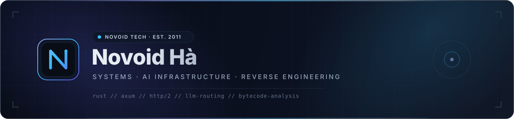

  

---

### `01` · Profile Overview

> **Builder & Systems Developer** *(b. 2011)* at **Novoid Tech** — focused on high-throughput **Rust** network infrastructure, deterministic **AI model routing**, and **static/bytecode reverse engineering**.

I design clean, low-overhead engineering systems with zero runtime bloat: native Rust proxies with HTTP/2 connection pooling, unified multi-provider gateways for AI coding agents, and rigorous static-first methodologies for analyzing obfuscated binaries and custom virtual machines.

---

### `02` · Core Engineering Pillars

<table>
  <tr>
    <td width="33.3%" valign="top">
      <h4>⚙️ Systems &amp; Rust Core</h4>
      
High-concurrency async services using <strong>Rust</strong>, <strong>Tokio</strong>, <strong>Axum</strong>, and <strong>HTTP/2</strong> — memory-safe proxies, embedded WebUIs, and deterministic daemon lifecycles.

    </td>
    <td width="33.3%" valign="top">
      <h4>🔀 AI Infrastructure</h4>
      
2-tier LLM gateways, multi-account OAuth rotation, schema sanitization, and unified <strong>Anthropic &amp; OpenAI</strong> protocol adapters for modern AI coding CLIs.

    </td>
    <td width="33.3%" valign="top">
      <h4>🛡️ Reverse Engineering</h4>
      
White-box static unpacking, invariant-anchored analysis, control-flow flattening recovery, and <strong>CPython bytecode</strong> / custom VM decompilation workflows.

    </td>
  </tr>
</table>

---

### `03` · Featured Projects — Novoid Ecosystem

| Project | Architecture & Role | Core Stack |
| :--- | :--- | :--- |
| ⚡ [**novoid-core**](https://github.com/hanovoid/novoid-core) | High-performance proxy engine translating **Anthropic Messages API** to **Google Cloud Code** with HTTP/2 pooling, multi-account OAuth load balancing, and an embedded WebUI. | `Rust` `Axum` `HTTP/2` `rust-embed` |
| 🔀 [**novoid-proxy**](https://github.com/hanovoid/novoid-proxy) | 2-tier AI proxy & smart `novoid-*` tier router unifying **Anthropic & OpenAI APIs** with per-group failover for OpenCode, Claude Code, Aider, Codex CLI, Goose & Crush. | `Rust` `Tokio` `Reqwest` `SSE` |
| 🧠 [**novoid-decompiler-system**](https://github.com/hanovoid/novoid-decompiler-system) | Systematic reverse-engineering rules, safety boundaries & unified AI agent skill for multi-layer obfuscators, custom VMs, and Python bytecode recovery. | `Python ABI` `AST` `AI Skills` `CLI` |

---

### `04` · Technology Stack

  

---

### `05` · GitHub Telemetry

<table>
  <tr>
    <td align="center" valign="middle">
      
    </td>
    <td align="center" valign="middle">
      
    </td>
  </tr>
</table>

---

  Crafted with precision by <strong>Novoid Hà</strong> · <a href="mailto:hanovoid@gmail.com">hanovoid@gmail.com</a>

